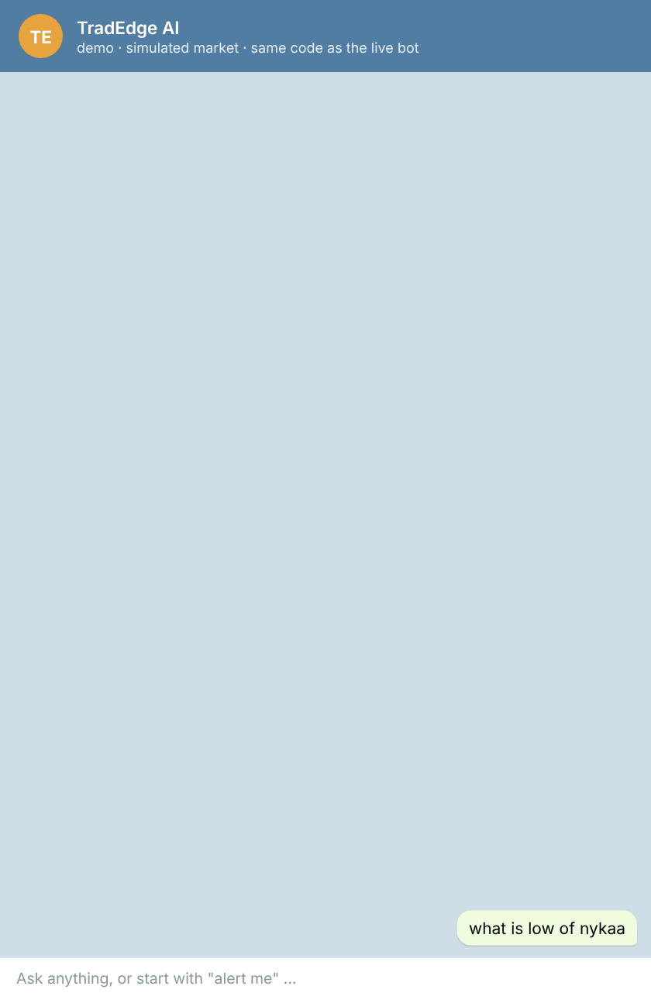
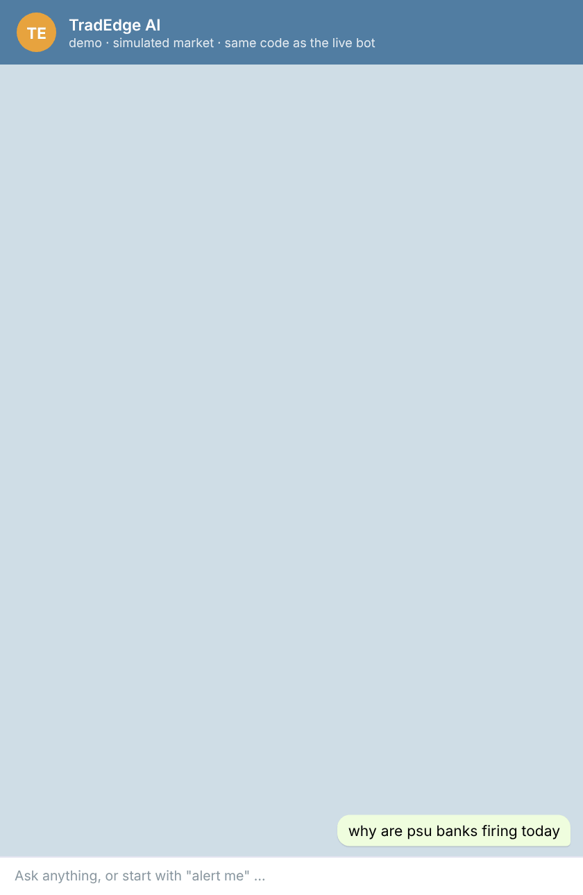
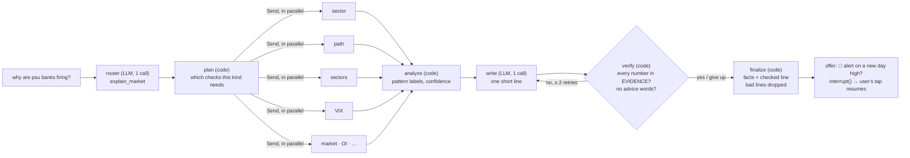
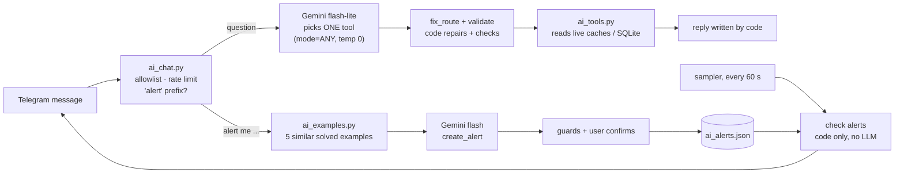

# TradEdge AI Assistant

[](https://github.com/sagarshah-dev/tradedge-ai-assistant/actions/workflows/tests.yml)
[](https://github.com/sagarshah-dev/tradedge-ai-assistant/actions/workflows/evals.yml)

A Telegram assistant for a live NSE F&O trading dashboard. Ask in plain English (or Gujarati / Hinglish),
get answers computed from live market data, ask **why** the market is moving, and set alerts in one sentence.

**The model never computes a number.** Gemini only picks one of 21 read-only tools and fills in its
arguments. Code validates the arguments, reads the live data and writes every number in the reply.
For "why" questions a **LangGraph** workflow runs the checks in parallel, lets the model write one line,
and **verifies every number in that line against the evidence** before it is sent.
Alerts are parsed by the model once, confirmed by the user, then checked every minute by plain code.

> This repo is the AI layer of a private trading app, published with a **fake market**
> (`fake_market/`, a seeded random walk) so anyone can run it. The trading app, its scanner and its
> strategy are not here, and no real results are published.

<table><tr>
<td></td>
<td></td>
</tr><tr>
<td align="center"><sub>Questions → one tool · an alert created, then fired by code</sub></td>
<td align="center"><sub>WHY agent (LangGraph) · OI build-up · odds · market watch → Why</sub></td>
</tr></table>
<p align="center"><sub>Rendered from the real code's output on the simulated market (<code>make_demo_media.py</code>), not drawn
by hand. Offline, the agent's one 🧠 line comes from a stand-in writer that reuses the code's labels; with a
<code>GEMINI_API_KEY</code> Gemini writes it and the same verifier checks it.</sub></p>

## What it can do

| Use case | Example | How it works |
| --- | --- | --- |
| Live screens | `stocks where open = high` · `top gainers today with price and rvol` | LLM picks a tool → code runs a typed condition / metric over the live caches |
| Any value | `what is low of nykaa` · `nykaa high and vwap` | LLM → `live_value`; code reads the field and its time |
| History | `top gainers last 5 days` · `how did SAGA stage perform last 30 sessions` | LLM → SQLite tools; code aggregates |
| OI build-up | `which stocks showed fresh OI buildup today` · `short build up stocks in bank` | Code classifies futures price × OI change (long / short build-up, covering, unwinding) and marks it *fresh* if OI barely moved in the 30 min before |
| **Why is it moving** | `why is nifty down` · `why are psu banks firing` · `why midcap up but nifty down` | **LangGraph agent**: plan → parallel checks → labels by code → LLM writes 1 line → **verifier** → answer + alert offer (human in the loop) |
| Alerts in one sentence | `alert me when nykaa goes below 348` · `…slips under today's low` | LLM (with 5 retrieved solved examples) → rule → guards → user taps ✅ → checked every minute by code, no LLM |
| Ready-made market watches | `/watch` → Futures flip · Fade / bounce · Breadth turn · Sector OI · VIX jump | Code only: a ping fires when a state *changes*, with a daily baseline, cooldown and cap; each ping has a 🧠 **Why** button that runs the agent |
| Signal odds | `odds SBIN` · `odds SAGA LONG` → 🔁 Loosen | Code only: today's signal → its most similar past signals (stage, side, RVOL, PACE, time, market) with a 95% range; *loosen* drops one condition at a time |
| Does ML beat the lookup? | `/mlreport` (offline `python ml_study.py`) | LightGBM vs the odds lookup, **walk-forward** by month, features only from *before* the signal, bootstrap over days; used only if the whole 95% range of the gain is above 0 |
| How is the bot doing | `/stats` · `/stats 7` | From the bot's own logs: questions, failures, p50 / p95 latency, tokens, how often code repaired the model, WHY-agent outcomes, last eval run |
| Refuses advice | `should I buy TATAMOTORS` | Router → `cannot_answer`; the agent's verifier also rejects advice words in the AI line |

## Try it (2 minutes)

```bash
pip install -r requirements.txt
python demo.py --tour        # scripted walk-through, no API key needed
python demo.py --offline     # type questions yourself; replays recorded model outputs
GEMINI_API_KEY=... python demo.py   # any question, real Gemini routing
```

```
you> what is low of nykaa
NYKAA  low 349.15 (10:49) · price 350.06 · day -0.55%

you> alert me when nykaa goes below 348
🔔 New alert — please confirm
Watch: NYKAA price ≤ 348
Check: every minute, 09:15–15:30 · today only · once per stock per day
   [1] ✅ Save   [2] ❌ Cancel

you> /tick 8
🔔 Alert #1 · 11:37 · NYKAA price ≤ 348
1 NYKAA  347.79  day -1.20%
```

That alert is a real case: the model's recorded output was *"day % change, filtered by price < 348"*.
A code guard turned it into the price alert the sentence asked for. The `--tour` replays exactly that.

## The WHY agent (LangGraph)



Five LangGraph features, each for a real need:

| Pattern | Why it is there |
| --- | --- |
| Conditional routing | a sector, an index, a stock, VIX and "rotation" need different checks |
| Parallel fan-out (`Send`) | 3–12 independent checks per question; running them together keeps the answer fast |
| Verifier loop (a cycle with a limit) | the model may only use numbers that the code produced; 2 retries, then the bad line is removed |
| Human in the loop (`interrupt` + `Command(resume)`) | the alert offer waits for a tap, and nothing is saved without it |
| Persistence (SQLite checkpointer) | a pending offer survives a restart; the button resumes the same run |

It is a controlled **workflow**, not a free-roaming agent: in a trading context every number must be checkable.
Without a model (quota out, outage) it still answers with the facts and labels from code. Evidence shows what
**moved together**; the wording never claims a cause and never advises. Anything not checked (news, FII / DII,
global cues) is listed as "not checked" instead of guessed.

## Odds and the ML study: "beat the baseline or don't ship"

`odds SBIN` takes the stock's latest scanner signal and finds its look-alikes in the past (same stage and
side, then RVOL band, PACE band, time of day, market direction), with the sample size and a 95% range.
Too few cases → it says so and offers **Loosen**, which drops one condition at a time. No LLM.

Why a lookup and not a model? About 300 independent signals over 55 days: a model's edge on that is inside the
noise. `ml_study.py` checks this honestly and re-runs as data grows:

- **label** WIN vs not; **features** only what was logged *at* the signal, so no look-ahead leakage
- **walk-forward** by month: train on every month before, test on that month
- **baseline** = the lookup the bot already uses; **score** = AUC, model vs baseline
- **noise** = bootstrap over test *days* (signals on one day move together)
- **verdict** "use" only if the whole 95% range of the gain is above 0 and there are ≥ 300 test events

## Market watches and `/stats`

`/watch` turns five ready-made alerts on or off (futures flip, fade / bounce, breadth turn, sector OI, VIX jump).
They are plain code. A ping fires only when a state **changes**; the first reading of the day is a baseline, so a
restart doesn't replay the morning; plus a cooldown per subject and a daily cap per watch. Without those three,
five watches on a moving market ping all day and the bot gets muted. Each ping has a 🧠 **Why** button.

`/stats` answers what an on-call person asks, from the bot's own logs: questions, model failures, p50 / p95
latency (model and whole answer), tokens, how often code had to repair or reject the model's output, the WHY
agent's outcomes (line accepted first try / after a retry / removed), and the last real-model eval run.

## Architecture



| File | One job |
| --- | --- |
| `ai_chat.py` | Telegram long polling, allowlist, rate limit, buttons, follow-up memory, sampler + alert thread |
| `ai_llm.py` | Gemini router: tool schemas, retries, fallback model, error kinds (quota vs outage vs 404) |
| `ai_tools.py` | 21 read-only tools, argument validation, `fix_route` repairs, replies, minute sampler |
| `ai_agent.py` | The WHY agent: LangGraph graph, verifier, alert offer, checkpointer |
| `ai_evidence.py` | The checks behind every WHY answer (code only): the single source of every number |
| `ai_watch.py` | Five ready-made market watches (code only), `/watch` card |
| `ai_odds.py` | Signal odds lookup + `/mlreport` (code only) |
| `ml_study.py` | Offline: does LightGBM beat the lookup? Walk-forward + bootstrap |
| `ai_stats.py` | `/stats` from the logs |
| `ai_extra.py` | Broader indices and crude, fetched for the assistant only (not started in the demo) |
| `evals/scorecard.py` | Real-model scorecard: router accuracy before / after code repair, latency, tokens, writer check |
| `ai_alerts.py` | Alert rules: validate, guards, JSON store, minute check, conversation with buttons |
| `ai_examples.py` | Hybrid retrieval of solved examples: char-trigram TF-IDF + embeddings, merged with RRF |
| `predeploy.py` | Tests + real-model evals → GO / NO-GO |
| `fake_market/` | The public stand-in for the private app's live caches and databases |

## Design decisions

**LLM = router, code = calculator.** Market data never goes to the model, only the question text.
A hallucinated number is not possible because the model never writes one.

**Typed tools, not text-to-SQL.** Three generic layers instead of one tool per question:
- a **metric table** (what × time window: % move, volume, futures volume, OI, PACE, VWAP crossings, ...)
- a small **condition language** over 19 live fields (`open = high`, `price > pdh`, `rvol ≥ 2`, AND, up to 6)
- a **value lookup** for any of those fields on any stock or index

A test is generated from the field list, so a field that can't be asked about fails in CI.

**Alerts: LLM once, code forever.** Turning a sentence into a rule is a language problem, so the model does it
once. Checking the rule every minute is a data problem, so plain code does it: no quota, same answer every time.
Defaults are *today only, once*; the bot asks only for a missing number; an AND rule with one part it can't
watch is refused, never half-saved.

**Retrieval for behaviour (dynamic few-shot).** Before the alert model is called, the 5 most similar
*solved* sentences are retrieved and put in the prompt. Keyword side: character trigrams (handles
"todays" vs "today's", typos, Hinglish). Meaning side: `gemini-embedding-001`. Merged with Reciprocal Rank
Fusion. If embeddings fail, it falls back to keyword-only and the alert still works. Every live failure
becomes a new example, so the bot improves without a code change.

**Model output is treated like user input.** Each live mistake became a deterministic guard that checks the
model's answer against the user's own words, plus a regression test that replays the exact wrong output:

| Guard | Live mistake | Fix in code |
| --- | --- | --- |
| Direction | "new day **low**" → model: new high | low / below vs high / above words → mirror the metric |
| Break vs near | "break today's low" → asked "how much?" | "break" without "near" → new-low event |
| Scope | "**watchlist** stock …" → all stocks | named scope missing from the rule → nothing saved |
| Price level | "below 348" → day % + filter | number + one price condition → price alert |
| Change vs level | "pace changes" → PACE ≥ ? | "change" → change event |
| Today vs history | "gainers today" → yesterday | "today" without past words → live tool |
| Honesty | tool can't do part of the ask | reply ends "⚠️ Can't do yet: …", never a silent swap |

## Testing and evals

| Layer | Size | Catches |
| --- | --- | --- |
| Unit + flow tests (fake model) | 564 tests, ~30 s | code bugs; full alert conversations including the user's reply to every bot question |
| Schema-driven tests | every list tool × limit / order / sector; every metric × window; every field | options the code silently ignores |
| Mirror tests | every high/low case with the side flipped | direction bugs |
| Mutation checks | code broken on purpose → a test must fail | weak tests |
| Agent trajectory tests | every question kind | the graph runs exactly the planned checks, in parallel, then the fixed steps |
| Real-model evals | 209 question + 86 alert sentences, leave-one-out | how the real model reads a sentence |
| Writer evals | ~22 WHY scenarios on the fake market, real model | lines accepted / retried / removed; "sent with an unchecked number" must be 0 |
| `predeploy.py` | all of the above | GO / NO-GO gate, also run in CI (`evals.yml`) |

Unit tests use a fake model that answers what I expect, so they pass by design. Only evals on the real model
show how it reads a sentence, so they gate the deploy. Leave-one-out: each alert case is scored without its own
example in the prompt, so the score measures unseen sentences.

Eval history (question router): 89% on 35 cases → 97% on 64 → 93% on 125 (median latency 4.5 s → 1.6 s).
`evals/scorecard.py` now also reports accuracy **before and after** code repair, so the share of answers that
code had to rescue is visible. The latest run is in **Actions → evals**.

## Reliability

- Free tier: 500 requests/day/model per Google project. Evals use a key from a separate project.
- Daily quota hit → straight to the fallback model, and the user is told when it resets. A 404 model is
  marked dead and skipped.
- Saved alerts survive restarts (atomic JSON writes). After a restart, time-window answers say what the bot
  could not see ("collecting since 12:10, 15-min window ready at 12:25") instead of inventing numbers.
- Only allowlisted chat IDs get an answer; others get silence, and never reach the model.
- Tools copy shared caches under a lock and compute outside it, so the trading engine is never slowed.

## Repo layout

```
ai_*.py            the assistant (same files as the private app)
demo.py            console version of the bot on the fake market
fake_market/       seeded fake session + schema.sql (only the columns the tools read)
state.py           public stand-in: F&O universe + sector map
make_demo_media.py rebuilds docs/*.gif from the real tour output
ml_study.py        offline ML study (writes data/ml_study.json)
docs/              demo.gif, demo-agent.gif + PNGs
tests/             564 tests, no network
evals/             real-model eval cases + runner
.github/workflows  tests on every push; real-model evals when AI code changes
```

## Not in this repo

The scanner, conviction score, tiers, PACE bands, scanner states and their rules are private, and so are the
real odds and ML-study results. `fake_market` uses stand-ins with made-up rules, and its past signals are
coin flips (no edge); names appear only because the tools can be asked about them. No keys, chat IDs or real
market data are committed (`config.py`, `data/`, `logs/` are ignored).

## Known limits

- The verifier checks that each number in the AI line **exists** in the evidence (with rounding), not that it is
  attached to the right subject. A line can reuse a real number for the wrong thing; the next step is to check
  number + subject pairs.
- The agent's checks are fixed per question kind. It does not yet re-plan when the evidence is weak.

## Next

- Text fields in the condition language (scanner state, tier, sector name).
- The same example retrieval for the question router.
- Expose the 21 tools as an MCP server, so any agent can use the same read-only tools
  (done for the farm bot: [ai-boat](https://github.com/sagarshah-dev/ai-boat)).
- Check number + subject pairs in the verifier.
